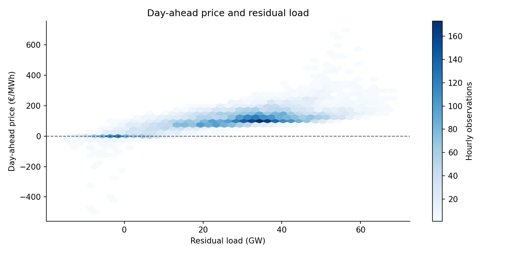

# German Electricity Market Monitor

**[View the live project report](https://iamkianasedighi.github.io/german-energy-demand-monitor/)**

I built a Python pipeline to find out when Germany's grid load is low relative to wind and solar generation, and whether those hours are also cheaper on the day-ahead electricity market.

**Data:** SMARD / Bundesnetzagentur · 1 Nov 2025–31 Oct 2026 · 8,760 hourly observations · DE load and generation + DE-LU prices.



## Findings

- **462 hours had negative wholesale prices.** All 462 were in the lowest quarter of residual load (≤16.9 GW). Negative-price frequency was **21.1%** in that quarter and **0.0%** in the other three quarters: a **21.1 percentage-point** gap (95% day-block bootstrap interval: **17.6–24.6 points**).
- **Midday and evening prices were far apart.** On 365 days with prices at both times, the median day-ahead price at **20:00 was about €116/MWh higher than at 13:00**; the evening price was higher on **90%** of those days.
- **Low residual load is seasonal.** In summer, 75% of observations at 14:00 fell in the year's lowest residual-load decile (≤3.5 GW), versus roughly 3% in winter.

The 10th-percentile threshold highlights when very low residual load occurs; the wider 25th-percentile group allows a comparison of negative-price rates. The price comparison selects the lowest and highest median-price clock hours automatically (13:00 and 20:00 for this period).

[Full report](results/2025-11_to_2026-10/report.md) · [Methods](docs/METHODS.md) · [SQL queries](sql/analysis.sql) · [Independent source audit](results/2025-11_to_2026-10/source_audit.json)

## Run locally

Requires Python 3.10+ and internet access to SMARD. No API key.

```powershell
python -m venv .venv
.\.venv\Scripts\Activate.ps1
python -m pip install -e ".[dev]"
python -m pytest -q -W error
python -m energy_monitor.run
```

The run writes `outputs/energy.sqlite`, a Markdown report, four charts, data-quality counts and run metadata. For later data or source revisions:

```powershell
python -m energy_monitor.run --update --end 2026-11-06
python -m energy_monitor.run --refresh
```

`--update` refetches an overlapping seven-day window and updates existing UTC-hour keys. `--refresh` downloads the requested period again. To independently verify a completed run against fresh SMARD files (without the pipeline cache):

```powershell
python scripts/verify_smard_independently.py
```

## How it's built

`SMARD weekly JSON → validation/cache → Pandas hourly series → SQLite → statistical analysis → report + four charts`

The raw table uses `(timestamp_ms, metric)` as its key; the hourly table uses UTC timestamps. Berlin dates are derived for daily and seasonal analysis, including daylight-saving changes. Missing values are not replaced with zeros. The comparison of negative-price rates uses a day-block bootstrap rather than treating adjacent hours as independent observations. The pipeline also runs in GitHub Actions for tests.

**Stack:** Python, Pandas, NumPy, SciPy, requests, SQLite, Matplotlib, pytest, GitHub Actions.

**Source:** [SMARD / Bundesnetzagentur](https://www.smard.de/en/datennutzung), CC BY 4.0. Market prices are wholesale DE-LU day-ahead prices. Neither the association with residual load nor the illustrative time shift establishes a causal effect or realized financial savings.
