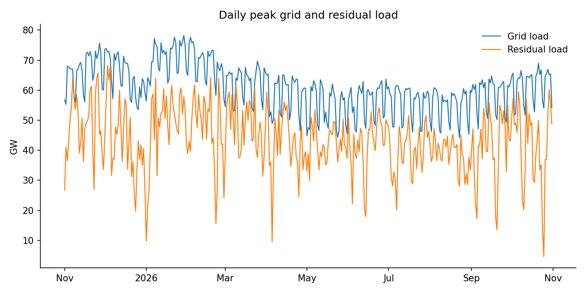
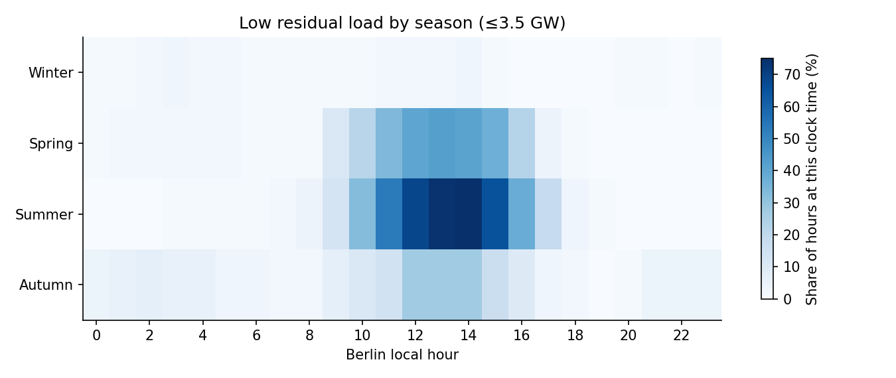
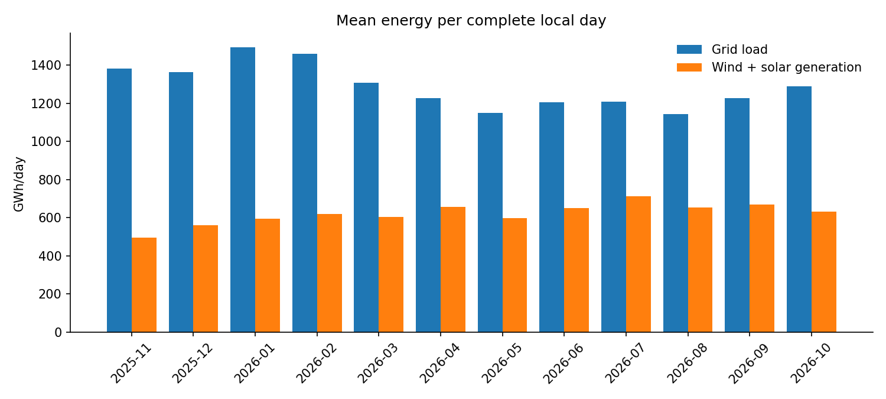
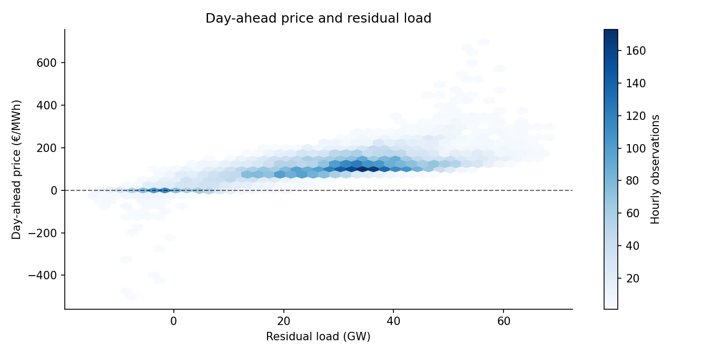

# German electricity demand, renewables and wholesale prices

**Period:** 2025-11-01 to 2026-11-01 (exclusive end, Berlin time)  
**Data:** Bundesnetzagentur SMARD, German load and generation (DE) and DE-LU day-ahead prices

## Decision

A flexible electricity consumer could examine whether some operations can be moved to historically lower-priced midday hours. Check its tariff, equipment constraints and forward prices before acting.

## Main findings

- The lowest **10%** of observed residual-load hours are at or below **3.5 GW**.
  The heatmap uses this threshold to highlight seasonal and hourly patterns.
  The price comparison uses the broader lowest **25%** to retain enough hours for a rate comparison.
- Highest observed grid load in any hour: **78.2 GW**.
- Source coverage: **8,760/8,760** complete
  load/generation hours (**100.0%**); **365** complete Berlin-local days.

## Low-residual-load hours by season

Percentages are calculated among observed hours **at that clock time in that season**.

| Season | Three most frequently low-residual hours |
| --- | --- |
| Winter | 03:00 (3%), 14:00 (3%), 02:00 (2%) |
| Spring | 13:00 (42%), 14:00 (41%), 12:00 (40%) |
| Summer | 14:00 (75%), 13:00 (74%), 12:00 (68%) |
| Autumn | 12:00 (27%), 13:00 (27%), 14:00 (27%) |

## Monthly context

Monthly values below are normalized per complete day rather than summed over months of different lengths.

| Month | Grid load (GWh/day) | Wind + solar generation (GWh/day) | Complete days |
| --- | ---: | ---: | ---: |
| 2025-11 | 1,382.3 | 496.0 | 30 |
| 2025-12 | 1,364.7 | 561.6 | 31 |
| 2026-01 | 1,493.3 | 593.4 | 31 |
| 2026-02 | 1,458.7 | 620.2 | 28 |
| 2026-03 | 1,308.5 | 604.4 | 31 |
| 2026-04 | 1,227.1 | 658.2 | 30 |
| 2026-05 | 1,149.7 | 599.3 | 31 |
| 2026-06 | 1,206.3 | 650.2 | 30 |
| 2026-07 | 1,209.5 | 713.8 | 31 |
| 2026-08 | 1,142.9 | 654.7 | 31 |
| 2026-09 | 1,227.4 | 669.6 | 30 |
| 2026-10 | 1,290.4 | 632.4 | 31 |

Low-residual-load hour counts use the same full-period bottom-decile threshold:

| Month | Low hours | Observed core hours |
| --- | ---: | ---: |
| 2025-11 | 0 | 720 |
| 2025-12 | 2 | 744 |
| 2026-01 | 22 | 744 |
| 2026-02 | 5 | 672 |
| 2026-03 | 14 | 743 |
| 2026-04 | 114 | 720 |
| 2026-05 | 121 | 744 |
| 2026-06 | 109 | 720 |
| 2026-07 | 161 | 744 |
| 2026-08 | 147 | 744 |
| 2026-09 | 94 | 720 |
| 2026-10 | 87 | 745 |

## Wholesale-price findings

- Valid matched price and load hours: **8,760** (100.0% of complete-load hours).
- Negative day-ahead price hours: **462**;
  **462** fell in the lowest residual-load quartile.
- In the lowest residual-load quartile (≤16.9 GW),
  negative-price frequency: **21.1%**; remaining hours:
  **0.0%**.
- Rate difference: **+21.1 percentage points**
  (95% day-block bootstrap interval
  **[+17.6, +24.6] percentage points**).
- Descriptive Spearman correlation of residual load and price: **0.69**.

Across **365** days with prices at both hours, the median 20:00 minus 13:00 price difference was **approximately €116/MWh** (20:00 was more expensive on 90% of those days). The hours are selected as the highest and lowest median-price clock hours in this observed period.

The wholesale-price spread is not a realized saving; tariff terms and operational flexibility determine whether shifting demand is useful.

## Data checks

- Missing measurements: grid_load=0, solar=0, wind_onshore=0, wind_offshore=0, residual_official=0, price_eur_mwh=0.
- Reconstructed vs published residual differs by more than 2% of grid load in
  **0/8760** comparable hours.
- Missing source values remain missing; genuine zeros remain zeros.

## Charts

## Scope

Residual load here is grid load minus photovoltaic and onshore/offshore wind generation;
this is not a direct measurement of dispatchable supply requirements. Prices are
DE-LU day-ahead wholesale values; since October 2025 the hourly price is the
average of four quarter-hour prices. The analysis describes historical observations
and does not establish causation.

Data source: **Bundesnetzagentur, SMARD** — CC BY 4.0. https://www.smard.de/en/datennutzung
